<!-- Generated from docs/templates/README.md.j2 by `make docs`. Edit the template, not this file. -->
# Northvale Credit: an approval policy that cuts losses without killing volume

**Question:** which applicants should a digital lender stop approving, and what is that worth, now that its grade-based rules no longer match the risk?

> **Case study: fictional company.** Northvale Credit is a fictional company invented for this project. The analysis uses public Lending Club loan data (Kaggle, 2007-2018) and was built for learning purposes. No real client, revenue or employer is represented.

**Deck:** [PDF](deck/Northvale_case_study.pdf) · [PPTX](deck/Northvale_case_study.pptx) · **Simulator:** [Streamlit app](app/streamlit_app.py) (`make app`; deployment steps in [DEPLOY.md](DEPLOY.md)) · **Notebooks:** [01 scope](notebooks/01_scope_and_target.ipynb) · [02 leakage](notebooks/02_leakage_audit.ipynb) · [03 EDA](notebooks/03_eda_default_drivers.ipynb) · [04 scorecard](notebooks/04_scorecard.ipynb) · [05 LightGBM + SHAP](notebooks/05_gradient_boosting_and_shap.ipynb) · [06 policy](notebooks/06_policy_and_pnl.ipynb)

## TL;DR

- **The grade drifted.** Default rates on 36-month loans rose from 12.3% (2013 vintage) to 14.9% (2015). The grade mix got slightly safer (-0.6 pp); riskier loans inside each grade added +3.1 pp, while prices fell. Rules written on grades now approve more risk for less return.
- **A model built only on application data ranks risk better than Lending Club's own sub-grade:** test AUC 0.701 vs 0.681 (LightGBM vs sub-grade), and it splits each grade into very different risks (grade C: 12.1% vs 29.9% default for its safest and riskiest fifths).
- **Recommendation: decline applicants whose LightGBM probability of default is above 27.9%.** On 161,997 loans issued July to December 2015 that no model saw during training or tuning, this keeps 91.0% of applicants (91.4% of dollar volume), cuts the default rate from 14.7% to 12.8% and moves realized profit from -$1.1M to $12.7M for the half-year.
- **Projected impact, under stated assumptions:** +$27.6M profit and $52.1M of credit losses avoided a year, on a book the size of the test window annualised ($4.2B a year). Range +$21.2M to +$40.5M across cost scenarios.

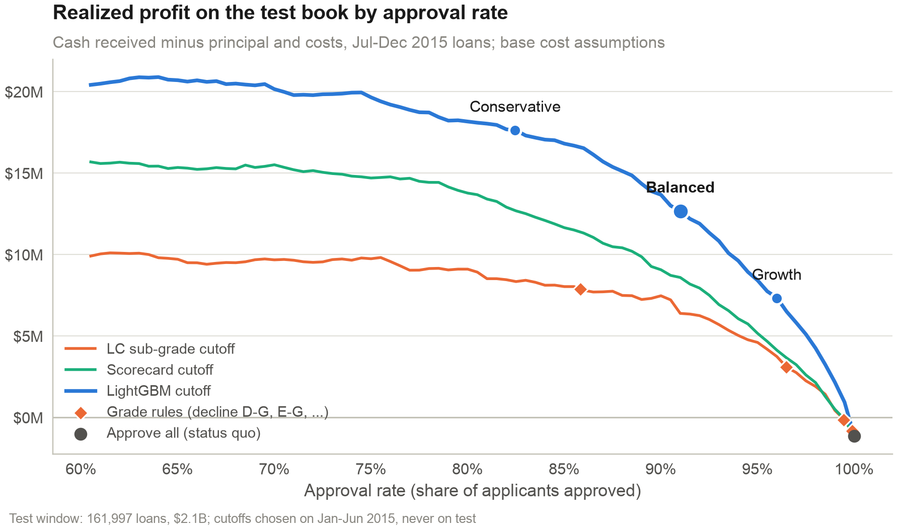

## 1. Business problem

Northvale Credit lends unsecured personal loans online. Its default rate is climbing and its approval rules are based on letter grades. The credit committee asked for **an approval policy that cuts expected losses without killing loan volume**, with a projected impact they can debate and a simulator a credit manager can use to test other cutoffs.

The decision this informs: at what estimated probability of default (PD) should an application be declined, given what each loan earns when it pays off and loses when it defaults.

## 2. Data

| | |
|---|---|
| Source | Lending Club accepted loans 2007-2018Q4, Kaggle dataset `wordsforthewise/lending-club` (file `accepted_2007_to_2018Q4.csv.gz`, 2,260,668 loans, 151 columns) |
| Licence | Listed as CC0: Public Domain on Kaggle (uploaded by Nathan George from LendingClub's public loan downloads). Used here for education only |
| Scope | 36-month loans issued January 2012 to December 2015, individual applications: 589,635 loans |
| Excluded | 147 loans still running at the snapshot, 239 joint applications (they start in October 2015 and do not exist in training) |
| Sample | 589,249 resolved loans, $7.4B lent, default rate 14.0% |
| Split (by issue month) | Train Jan 2012-Dec 2014: 306,462 loans (13.2% default) · Validation Jan-Jun 2015: 120,790 (15.1%) · Test Jul-Dec 2015: 161,997 (14.7%) |

**Why 36-month loans from 2012 to 2015.** The original brief suggested 2015-2018. At the data snapshot, 28% of 36-month loans issued in 2016 and 60% of those issued in 2017 were still running. Keeping only their finished loans would over-sample early defaults and early payoffs and bias the default rate. For 36-month loans issued 2012-2015, only 0.02% are unresolved. 60-month loans are left out (33% of the 2015 vintage still running) and listed as a next step.

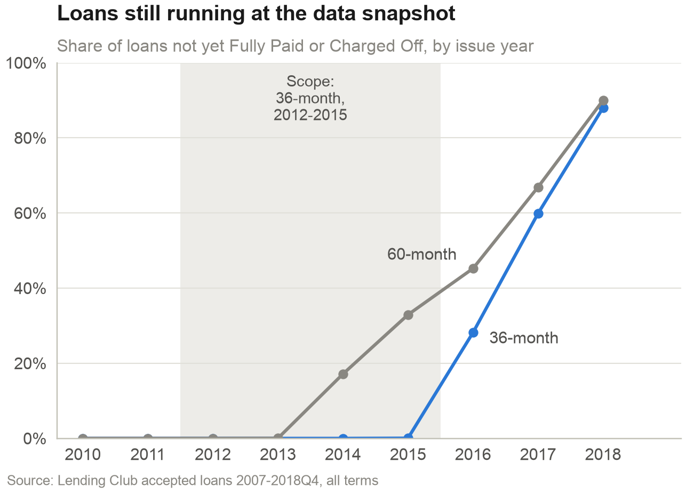

**Known quirks.** Every loan in the file was approved by Lending Club, so the data says nothing about rejected applicants. FICO at application starts at 660 (Lending Club's floor). Many bureau fields (for example `tot_cur_bal`, `mort_acc`) only start in mid-2012, so they are empty for the first months of training; LightGBM and the scorecard's missing bin handle this. The 2.26M-row CSV is never loaded into pandas: DuckDB reads only the columns each query needs.

## 3. Approach

1. **Target.** Default = `Charged Off` or `Default`; good = `Fully Paid`. Loans still current, in grace or late at the snapshot are excluded and counted per vintage (`reports/tables/scope_flow.csv`).
2. **Out-of-time split.** Train on 2012-2014, tune and recalibrate on January-June 2015, test once on July-December 2015. A random split would let the model learn from loans issued after the ones it is scored on.
3. **Leakage audit.** Every one of the 151 raw columns has a documented decision in [`docs/feature_audit.csv`](docs/feature_audit.csv): available at application or not, category, keep or drop, and why. 63 application-time features remain. Lending Club's grade, sub-grade, interest rate and instalment are excluded as features: they are the incumbent model's output, so they serve as the benchmark and in the P&L.
4. **Three rankers.** (a) Lending Club sub-grade, the incumbent. (b) A logistic scorecard on weight-of-evidence bins (optbinning, monotonic bins, IV filter, correlation filter, coefficient sign check, 600 points at 50:1 odds, 20 points to double the odds). (c) LightGBM with early stopping on validation and a small grid. All three are recalibrated on validation (Platt scaling) because 2015 defaulted more than 2012-2014.
5. **Explanations.** SHAP values on LightGBM, turned into plain-English reason codes for each applicant.
6. **Money, not AUC, picks the cutoff.** Expected profit per loan = principal x [(1 - PD) x G - PD x L - costs], with G and L measured on the training window. The cutoff is chosen on validation and judged on the test window with the cash each loan actually returned.

## 4. Findings

### 4.1 The same grade meant more risk at a lower price in 2015

| Grade | Default rate 2013 | Default rate 2015 | Avg. rate 2013 | Avg. rate 2015 |
|---|---|---|---|---|
| A | 4.6% | 5.4% | 7.7% | 6.9% |
| B | 9.8% | 11.9% | 11.8% | 10.0% |
| C | 15.3% | 19.4% | 15.4% | 13.2% |
| D | 20.4% | 26.2% | 18.7% | 16.6% |
| E | 23.3% | 32.8% | 21.6% | 19.1% |

Default rates rose inside every grade while interest rates fell in grades A to E. Splitting the +2.6 pp rise between 2013 and 2015: the grade mix contributed -0.6 pp (it shifted toward safer grades) and higher default rates within grades contributed +3.1 pp. By quarter, the default rate bottomed at 11.9% (2013-Q4) and peaked at 15.4% (2015-Q2). This is an association across vintages, not a causal estimate: Lending Club's pricing, marketing and the credit cycle all changed at once.

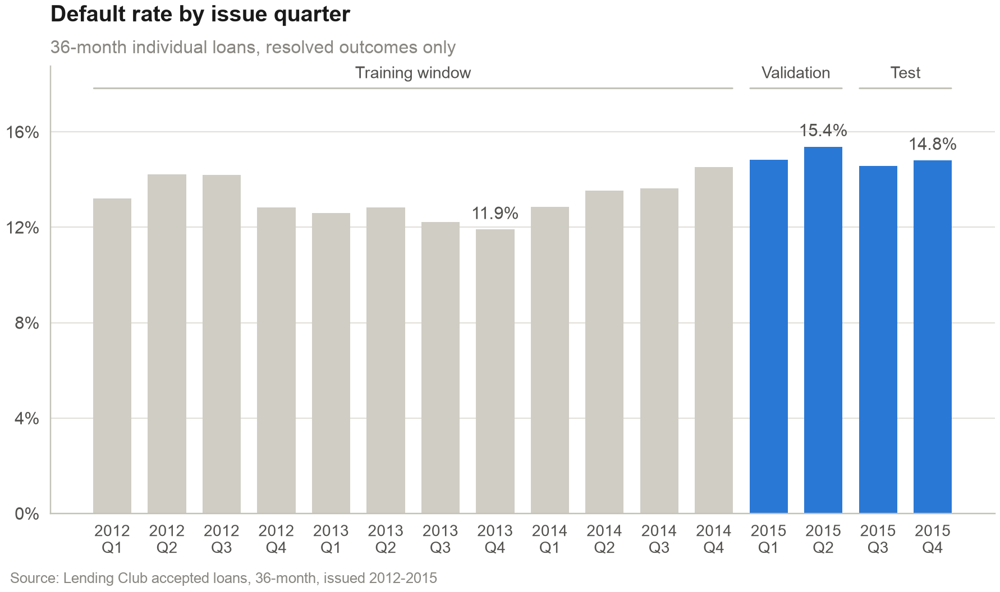

### 4.2 Post-origination fields look like magic and are useless at decision time

A single-column screen on the training window ranks every raw field by how well it separates defaults on its own. The 9 columns above 0.70 are all recorded after the loan is issued (strongest: `last_fico_range_high` at 0.89). The best genuine application field, FICO, reaches 0.60; Lending Club's sub-grade 0.65. Retraining the final LightGBM with one leaked field shows the damage: test AUC goes from 0.701 to 0.948 with the refreshed FICO score and to 0.9998 with principal repaid to date.

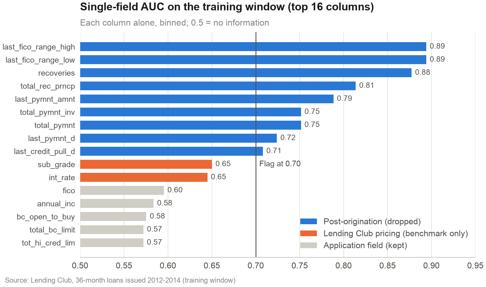

Other drops, all justified in the audit file: identifiers and free text (`emp_title` has very high cardinality and can proxy for protected characteristics), `zip_code` and `addr_state` (geography can proxy for race and ethnicity; ECOA / Regulation B in the US, and the EU AI Act classes creditworthiness scoring as high-risk), 14 bureau fields that only exist from late 2015, and 16 joint-applicant fields.

### 4.3 LightGBM beats the incumbent grade; the scorecard roughly matches it

| Test window (161,997 loans) | LC sub-grade | Scorecard (13 characteristics) | LightGBM (63 features) |
|---|---|---|---|
| AUC | 0.681 | 0.675 | 0.701 |
| Gini | 0.363 | 0.349 | 0.402 |
| KS | 0.267 | 0.253 | 0.292 |
| Brier score | 0.1189 | 0.1192 | 0.1171 |
| Mean PD vs observed | 14.5% vs 14.7% | 14.5% vs 14.7% | 14.6% vs 14.7% |
| PSI of the score, train vs test | 0.023 | 0.004 | 0.005 |
| Defaults caught by declining the riskiest 10% | 20.6% | 20.9% | 23.0% |

The AUC gain over the grade is modest (0.019), as expected when the incumbent already uses FICO and bureau data. It is still information the grade does not have: inside grades A to E, the default rate of the model's riskiest fifth is 2.1x to 5.8x that of its safest fifth, and a logistic blend of LightGBM and the sub-grade reaches 0.710 on test. Before recalibration, both models under-predicted 2015 defaults (LightGBM mean PD 13.5% against 14.7% observed), because they learned from a calmer period; Platt scaling on January-June 2015 fixes the level without changing the ranking. The scorecard's simplicity costs it 0.026 of AUC against LightGBM.

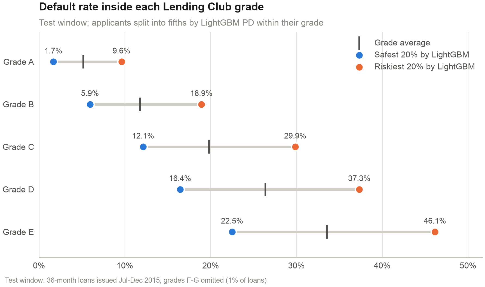

| 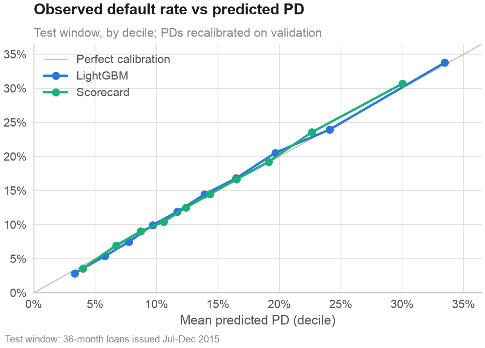 | 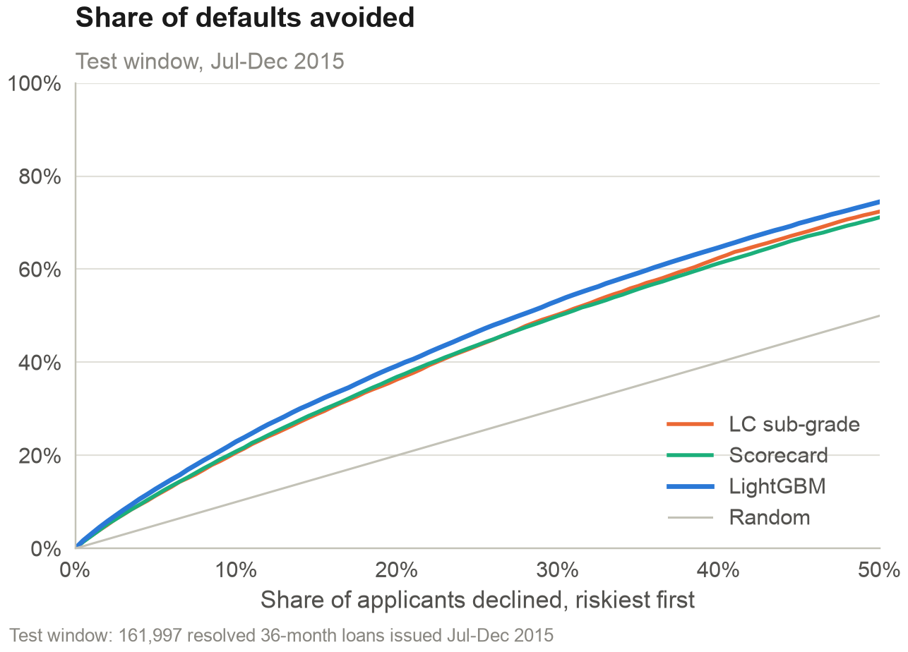 |
|---|---|

### 4.4 FICO, loan size relative to income and recent credit-seeking drive the score

The five features with the largest mean absolute SHAP value are: FICO score at application; Loan amount / annual income; Accounts opened, last 24 months; Debt-to-income ratio (%); Annual income. Together they carry 28% of the total effect. The dependence plots show sensible, monotonic shapes: risk falls steadily with FICO and rises with loan-to-income and with the number of accounts opened recently. Each applicant's largest positive contributions become reason codes, for example for one declined applicant: "FICO score of 667 (median applicant 692)"; "7 credit accounts opened in the last 24 months (median 4)".

| 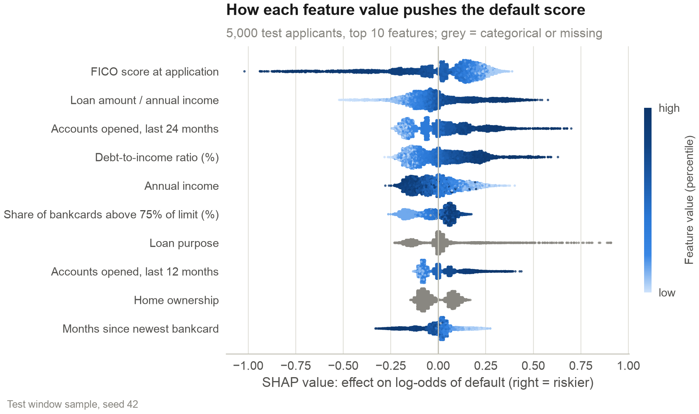 | 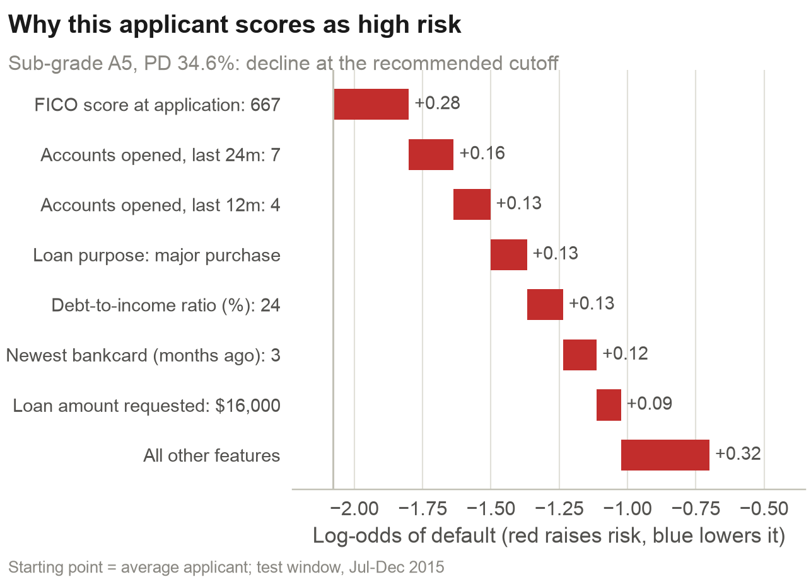 |
|---|---|

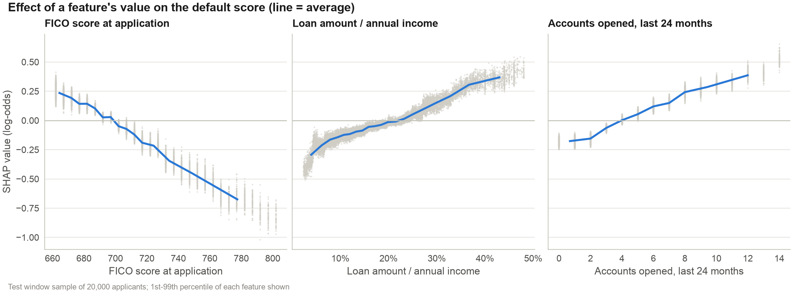

### 4.5 Price does not cover risk at the top of the book

With base assumptions a loan breaks even at PD = (G - costs) / (G + L): 7% for loans priced under 8%, 35% for loans priced at 20% or more. On the test window, loans priced at 20% or more defaulted 42.2% of the time, for a realized profit of -$1.4M. Ranking applicants by expected margin (which rewards high prices) instead of by PD changed realized profit by -$2.7M at the same approval rate, so the recommended rule is a plain PD cutoff.

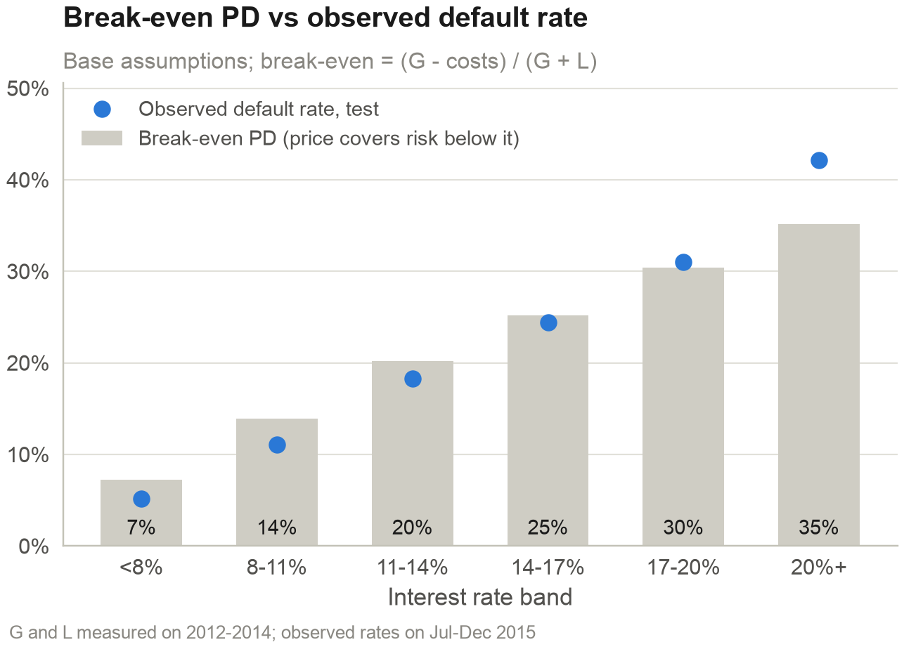

## 5. Recommendation and expected impact

**Decline applications with a LightGBM PD above 27.9%** (the "balanced" option). The cutoff maximises expected profit on January-June 2015 subject to approving at least 90% of applicants, the committee's volume constraint. It was then applied once to the July-December 2015 loans:

| Test window, Jul-Dec 2015 | Approve all (today) | Decline grades D-G | Conservative | **Balanced (recommended)** | Growth |
|---|---|---|---|---|---|
| PD cutoff | none | n/a | 22.7% | **27.9%** | 33.3% |
| Approval rate | 100.0% | 85.8% | 82.5% | **91.0%** | 96.0% |
| Dollar volume kept | 100.0% | 86.6% | 83.6% | **91.4%** | 96.0% |
| Default rate, approved | 14.7% | 12.4% | 11.5% | **12.8%** | 13.7% |
| Net credit loss | $116.9M | $82.6M | $74.3M | **$90.9M** | $103.1M |
| Realized profit (half-year) | -$1.1M | $7.9M | $17.6M | **$12.7M** | $7.3M |

At the same approval rate as the "decline grades D-G" rule (85.8%), a LightGBM cutoff earns $16.6M against $7.9M, with a default rate of 11.9% against 12.4%. The scorecard at the balanced approval rate adds +$9.5M against LightGBM's +$13.8M: the price of the simpler model.

**What the recommended cutoff declines:** 14,575 applicants, of whom 34.2% defaulted. It gives up $16.1M of profit on 9,595 good loans and avoids larger losses on the rest, for a net realized gain of +$13.8M in six months.

**Annual view.** The test window covers six months, so annual figures double it: a book of 323,994 loans and $4.2B a year. Under base assumptions that is +$27.6M profit, $52.1M of net credit losses and 9,960 defaults avoided, for $357.6M less lending.

**Assumptions (G and L measured on 2012-2014 loans; costs are editable in the simulator):**

| Assumption | Low (favourable) | Base | High (adverse) | Source |
|---|---|---|---|---|
| G: net interest earned per $ on loans that pay off, 11-14% band | 17.4% | 16.9% | 16.8% | Best / pooled / worst training year |
| L: net loss per $ on a defaulted loan | 35.2% | 35.9% | 38.3% | Best / pooled / worst training year |
| Cost of funds, annual | 3.0% | 4.0% | 6.0% | Assumption |
| Principal-years outstanding per $ lent | 1.30 | 1.30 | 1.30 | Interest received / rate, training |
| Operating cost, share of principal | 0.5% | 1.0% | 2.0% | Assumption |
| **Annual profit gain of the balanced cutoff (realized cash)** | **+$21.2M** | **+$27.6M** | **+$40.5M** | Test window x 2 |
| Annual profit gain (expected, PD x assumptions) | +$10.6M | +$19.3M | +$35.8M | Test window x 2 |

Realized profit uses each loan's actual cash, so only the cost assumptions move it; expected profit also depends on G and L. The cash fields were checked before use: `total_pymnt` equals principal + interest + late fees + recoveries to within 0.01 dollars on every loan, and defaulted loans repaid 42.0% of principal before charge-off. No time value of money is applied.

**Expected vs realized.** Expected profit overstates realized profit by 1.1% of the test book. The main reason: 2015 defaults lost 39.4% of principal against 35.9% in training. Read the expected numbers as optimistic, and the realized ones as what the policy would have earned on these loans.

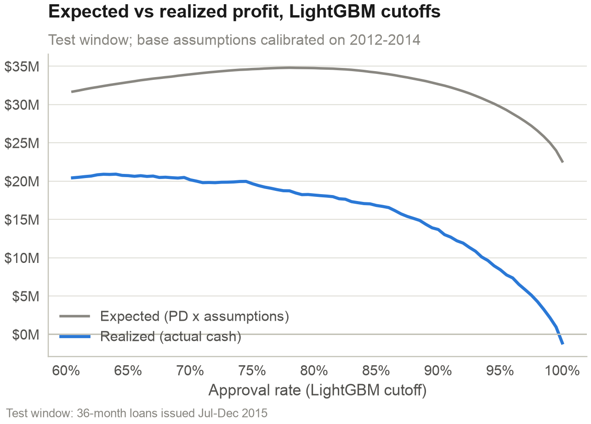

### The simulator

The Streamlit app lets a credit manager pick the model, set the cutoff by approval rate or by PD, change every assumption, compare with a grade rule and read the reason codes of 200 test applicants. It reads only small precomputed files in `app/data/` and needs no model library at runtime.

| 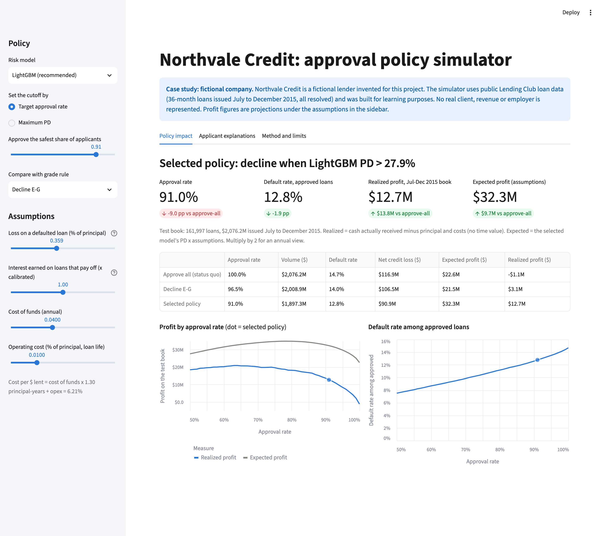 | 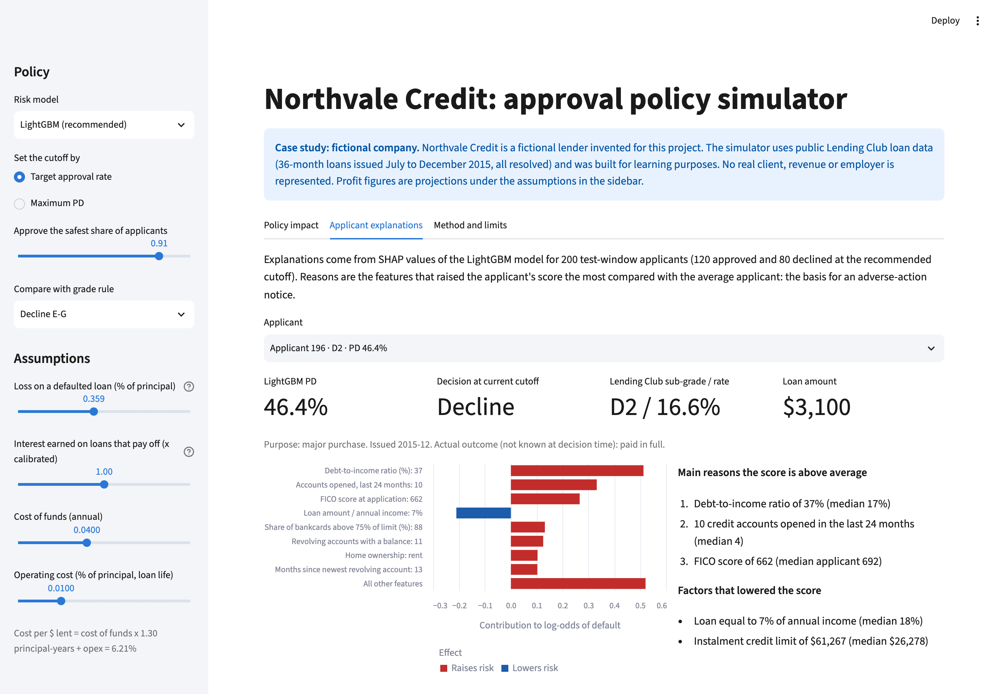 |
|---|---|

## 6. Limitations and what I would do next

- **Accepted loans only.** Applicants Lending Club rejected never received a loan, so their outcomes do not exist and there is no reject inference. The recommended policy can only tighten; approving segments Lending Club declined would need a test on live traffic.
- **Selected population.** FICO starts at 660 and every borrower passed Lending Club's own filters. Results do not transfer to thin-file or subprime applicants.
- **Pricing held fixed.** The analysis takes Lending Club's prices as given. The 20%+ band loses money at observed default rates; re-pricing it is a separate decision with its own demand effects.
- **One credit cycle.** 2012-2015 was a benign period in the US. Losses on 2015 defaults already ran above the training calibration (39.4% vs 35.9%).
- **Marketplace vs balance sheet.** Lending Club sold loans to investors; Northvale is framed as a lender funding its own book, so cost of funds and operating costs are assumptions, not data.
- **Modest discrimination gain.** LightGBM adds 0.019 AUC over the sub-grade. Most of the value comes from using a calibrated PD and an explicit profit rule, not from model complexity.
- **Fairness not yet tested.** Protected attributes are not in the data, so approval and error rates by group cannot be measured directly. A fair-lending review (for example with BISG proxies) would come before any deployment.
- **No time value of money** in the P&L; a loan that defaults late is treated like one that defaults early.

**Next:** a champion-challenger trial on live applications; monthly monitoring of score PSI (alert at 0.25; today 0.005), vintage default curves and manual override rates; 60-month loans once enough vintages resolve; monotonic constraints in LightGBM so its shape can be signed off like a scorecard.

## 7. How to reproduce

Requirements: macOS or Linux, Python 3.11, Node 18+ (deck only), LibreOffice (`soffice`, PDF export), about 2 GB of free disk. On macOS, LightGBM needs OpenMP: `brew install libomp`.

```bash
make setup   # .venv, pinned requirements, npm ci for the deck builder
make all     # data, build, analysis, notebooks, docs, deck, test
```

`make data` downloads the Kaggle bundle (about 1.3 GB, no login needed), extracts only the accepted-loans file and checks its SHA-256. A full `make setup && make all` from a fresh clone, with the raw file already in `data/raw/` and Python packages already in the pip cache, took 4 minutes on an Apple-silicon laptop (first-time package downloads add a few minutes). Seeds are fixed (`SEED = 42`); LightGBM runs with 4 threads in deterministic mode. Other targets: `make app` (simulator), `make deck-qa` (slide images), `make clean`.

## 8. Repo map

```
northvale/
  Makefile                      single entry point
  sql/                          DuckDB queries: status by vintage, scope
  src/northvale/
    build.py                    raw CSV -> typed parquet (DuckDB, column projection)
    scope.py                    censoring, vintages, grade mix vs within-grade decomposition
    audit.py                    decision for every raw column, AUC screen, leakage demo
    features.py                 application-time features and labels
    models.py                   sub-grade benchmark, WoE scorecard, LightGBM, calibration, metrics
    explain.py                  SHAP and reason codes
    pnl.py                      cash checks, G and L, policy curves, cutoffs, scenarios
    figures.py                  every chart (viz.py style)
    analysis.py                 runs everything, writes reports/metrics.json
    deck_content.py             deck text from metrics.json
    render_docs.py fmt.py viz.py check_text.py
  notebooks/                    01-06, narrative, executed by make notebooks
  reports/metrics.json          every number quoted anywhere
  reports/figures/ tables/      charts and supporting tables
  docs/                         feature audit, data dictionary, decision log, model card, templates
  app/                          Streamlit simulator + its small data files
  deck/                         deck builder, spec, PPTX and PDF
  tests/                        data assumptions and metric sanity checks
```

## Author

Ali Chamas · MSc Digital Business & Analytics, EMLV (Paris) · [LinkedIn URL]

Data: Lending Club loan data via Kaggle (`wordsforthewise/lending-club`), CC0. Northvale Credit is fictional; nothing here describes a real lender's results.
